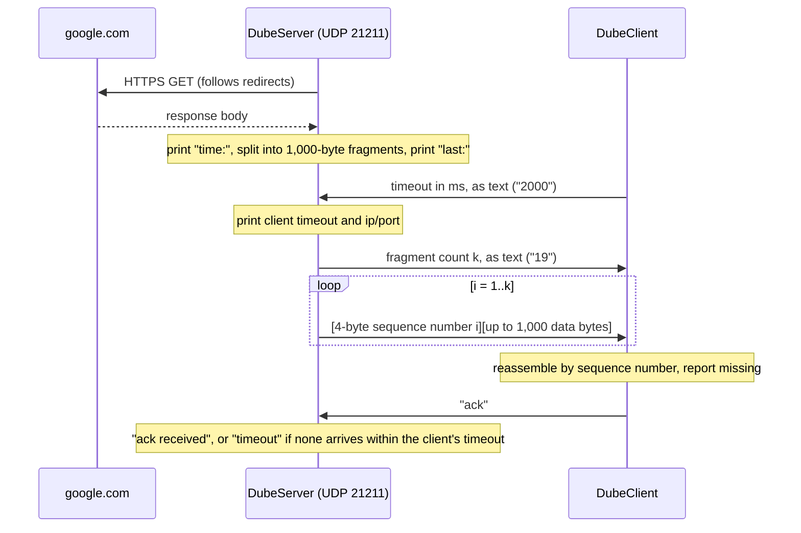

# PacketForge

A Java UDP client-server that moves a web page across UDP in numbered pieces. The server downloads `https://google.com`, splits the response into 1,000-byte fragments, and sends them to a client over UDP. The client puts the fragments back together in order, reports any that are missing, and sends an acknowledgment. The server waits for that acknowledgment only as long as the client asked it to.

Built with plain JDK classes: `java.net.http.HttpClient`, `DatagramSocket`, and `ByteBuffer`. No external libraries.

## How it works



### Message formats

| Message | Direction | Format |
| --- | --- | --- |
| Timeout | client to server | ASCII decimal milliseconds, e.g. `2000` |
| Fragment count | server to client | ASCII decimal `k`, e.g. `19` |
| Fragment | server to client | 4-byte big-endian sequence number (1 to k), then up to 1,000 bytes of data |
| Acknowledgment | client to server | ASCII `ack` |

Every fragment except the last carries exactly 1,000 data bytes, so a fragment packet is at most 1,004 bytes. The last fragment carries whatever remains.

## Requirements

- Java 11 or later (uses `java.net.http.HttpClient`)
- Internet access on the server machine, to reach google.com

## Build and run

Both classes are in package `org.example`.

```bash
# compile
javac -d out src/main/java/org/example/DubeServer.java src/main/java/org/example/DubeClient.java

# terminal 1: start the server
java -cp out org.example.DubeServer

# terminal 2: start the client
java -cp out org.example.DubeClient [host] [timeoutMs] [ackDelayMs]
```

Adjust the source paths if your files live somewhere else.

| Client argument | Default | Meaning |
| --- | --- | --- |
| `host` | `localhost` | Server host name or IP address |
| `timeoutMs` | `2000` | How long the server should wait for the acknowledgment |
| `ackDelayMs` | `0` | Test option: wait this long before sending `ack` |

### Examples

Normal transfer:

```bash
java -cp out org.example.DubeClient localhost 2000
```

Force a server timeout. The client waits 3 seconds before acknowledging, but told the server to wait only 1 second:

```bash
java -cp out org.example.DubeClient localhost 1000 3000
```

## Sample output

Byte counts and times depend on the page Google returns.

Server:

```
time: 412 ms
last: 337 bytes
Listening on UDP port 21211...
timeout: 2000 ms
client: 127.0.0.1/53418
ack received
```

Client:

```
Sent timeout 2000 ms to localhost:21211
k: 19
fragment 1: 1000 bytes
fragment 2: 1000 bytes
...
fragment 19: 337 bytes
received 19/19 fragments, 18337 bytes total
last: 337 bytes
ack sent
```

## Design notes

- **Ordered reassembly.** The client stores each fragment at its sequence number in a `byte[k + 1][]` array. Fragments are placed correctly even if they arrive out of order, and duplicates or out-of-range numbers are ignored.
- **Missing-fragment detection.** If the client gets no packet for 5 seconds, it stops waiting and lists the missing sequence numbers.
- **Client-controlled timeout.** The server sets its receive timeout to the value the client sent, then waits for the acknowledgment.
- **Error handling.** A non-numeric timeout, an HTTP failure, or a UDP error ends the program with a clear message.

## Known limitations and roadmap

- **One client at a time.** The server handles a single client and then exits. Next: a receive loop that hands each client to its own thread on an `ExecutorService`, with each client served from a separate socket.
- **No retransmission.** Lost fragments are reported but not re-sent. Next: selective repeat, where the client requests the missing sequence numbers.
- **The client acknowledges partial transfers.** It sends `ack` even when fragments are missing. Next: acknowledge only complete transfers and print `fail` otherwise.
- **The client's wait time is fixed at 5 seconds.** It does not reuse the timeout it sends to the server.
- **Reassembled data is counted, not printed.** The client reports byte totals instead of printing the page.
- **No integrity check.** A per-fragment checksum (CRC32) would detect corrupted data.
